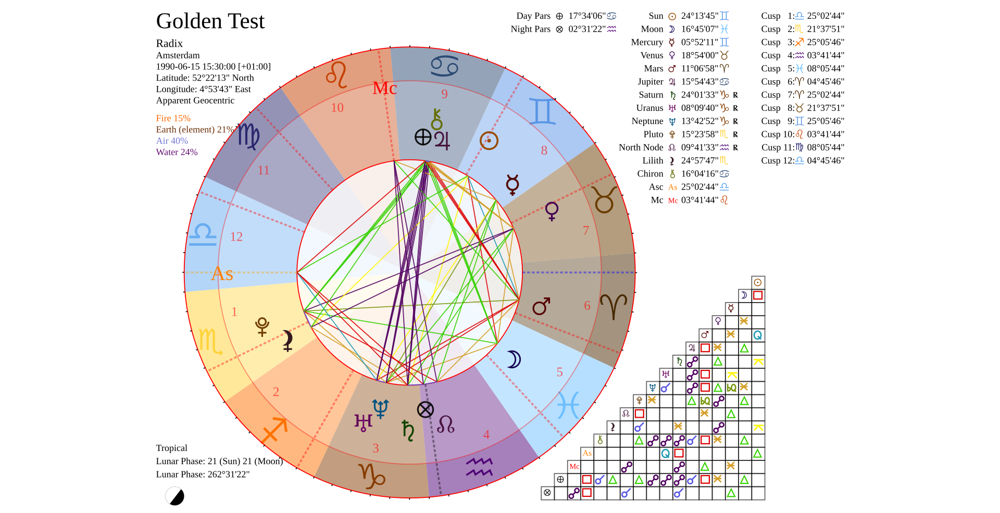
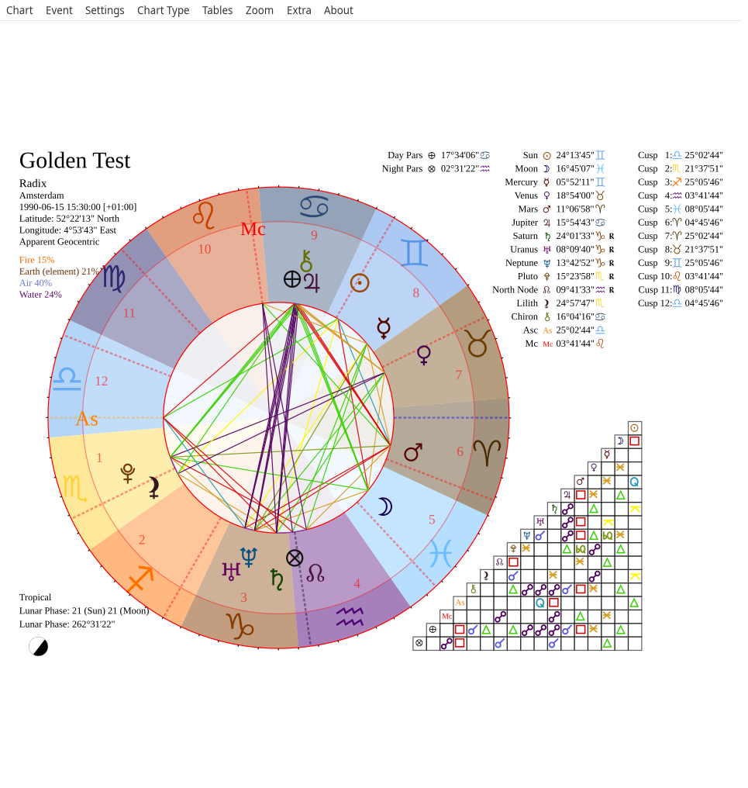
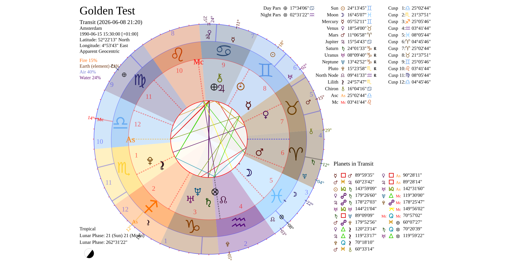
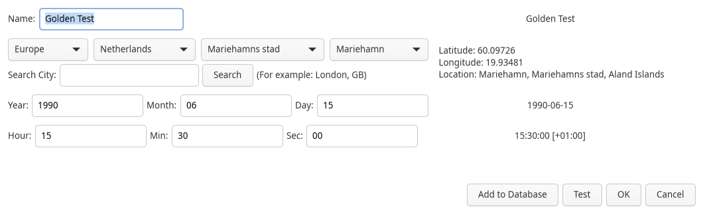
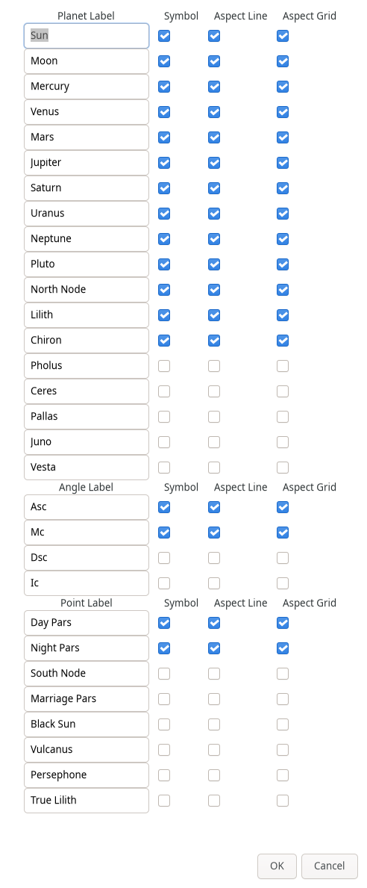

Getting started
===============

Screenshots
-----------

   Natal chart wheel (Amsterdam, 1990-06-15).

   Main window with chart, data table, and toolbar.

   Transit chart (outer ring) over the natal wheel.

   Event editor for birth date, time, and location.

   Planets & angles settings.

Installation
------------

Clone the repository and run the install script:

.. code-block:: bash

   git clone https://github.com/YOUR_ORG/astrology.git
   cd astrology
   ./install.sh
   source .venv/bin/activate
   astrology

System packages (Debian/Ubuntu):

.. code-block:: bash

   sudo apt install python3-dev python3-gi python3-gi-cairo \
     gir1.2-gtk-4.0 gir1.2-rsvg-2.0 librsvg2-bin imagemagick

Ephemeris data
--------------

Swiss Ephemeris ``.se1`` files are fetched on install. To skip:

.. code-block:: bash

   ASTROLOGY_SKIP_EPHE_UPDATE=1 ./install.sh

User data
---------

Charts and settings are stored under ``~/.config/com.youniverse.astrology/`` by default
(see :mod:`astrologymod.branding`).

Chart import and export
-----------------------

Use **Chart -> Save Chart** to write the current chart as a native ``.yac``
XML file. A ``.yac`` file stores the event name, local datetime, location,
coordinates, altitude, country code, timezone offset, timezone name, and
geonames id. Opening a native chart with **Chart -> Open Chart** replaces the
current chart in the main window.

Use **Chart -> Import** for legacy formats:

.. list-table::
   :header-rows: 1

   * - Menu item
     - File type
     - Behavior
   * - ``Oroboros (*.xml)``
     - Oroboros chart XML
     - Opens the first chart record and resolves the nearest bundled geonames
       entry from its coordinates.
   * - ``Astrolog (*.dat)``
     - Astrolog/Astrolog32 ``/qb`` and ``/zi`` files
     - Opens one chart, deriving timezone data from the parsed coordinates.
   * - ``Skylendar (*.skif)``
     - Skylendar XML
     - Opens the first ``DATASET`` record.
   * - ``Zet8 Dbase (*.zbs)``
     - Zet8 database export
     - Imports all parsed rows into the natal chart database instead of opening
       a single chart in the window.

Use **Chart -> Export** for rendered chart files. ``SVG`` copies the generated
chart SVG; ``PNG`` and ``JPG`` render that SVG through librsvg and Cairo. The
ImageMagick ``convert`` fallback is only used when
``ASTROLOGY_ALLOW_IMAGEMAGICK`` is set to ``1``, ``yes``, or ``true``.
**Chart -> Export -> PDF File** uses GTK printing at 300 DPI on landscape A4.

Database backup and restore
---------------------------

The **Extra -> Export Database** action copies the user people database to a
``.sql`` file. **Extra -> Import Database** validates that the input database
contains the expected ``event_natal`` schema, writes a ``.bak`` backup beside
the active people database, and then merges records. Duplicate chart names are
kept by appending `` (#N)`` suffixes.

Running from source
-------------------

.. code-block:: bash

   source .venv/bin/activate
   python src/astrology

Troubleshooting
---------------

- **Window does not appear:** check ``echo $DISPLAY``; stop stuck instances with
  ``pkill -f '.venv/bin/astrology'``.
- **``gi`` import errors in venv:** re-run ``./install.sh`` (ensures
  ``system-site-packages`` is enabled for PyGObject).
